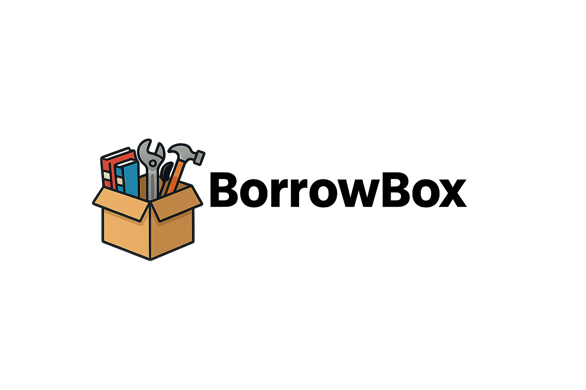

# BorrowBox

**Borrow, Rent, Share — All in One Place.**

BorrowBox is a community marketplace for lending and renting everyday items like tools, kitchen gear, books, electronics, and sports equipment, so people can share what they already own instead of buying something they'll only use once. It's a single-page web app written in plain HTML, CSS, and JavaScript, with all data stored in the browser's `localStorage`. There's no server, no build step, and no dependencies.

**Live demo:** https://alexgrosmn.github.io/BorrowBox/

## Features

**Browsing and search**
- Home page search across listings, which can also jump to pages by name (e.g. "dashboard")
- Shop page with filters for category, listing type (borrow/rent), minimum seller rating, and keyword
- Item pages with photo, price, description, seller rating, and estimated drop-off time

**Listing items**
- List an item as free to borrow or for rent at a weekly price
- Upload a photo (stored as base64) or paste an image URL
- Edit or remove your listings from the dashboard

**Borrowing and renting**
- Three handoff options at checkout:
  - Meet at a neutral location (address and time)
  - Go to the seller's location
  - Drop-off zone with a code-locked box (generates a 6-digit access code)
- If you aren't logged in, the app remembers what you were trying to borrow or rent and resumes checkout after you sign in
- Transaction history on the dashboard

**Accounts and reviews**
- Sign up and log in, with a settings page to change your name, email, or password, log out, or delete your account
- 1–5 star seller reviews with written comments
- Seller profiles showing average rating, review history, and lend/lease counts

**Community pages**
- Community Guidelines (with an "I Agree" acknowledgement), About Us, and Contact

## Tech stack

- HTML5, CSS3, vanilla JavaScript (ES6+)
- Hash-based client-side routing (`#/shop`, `#/item/<id>`, `#/checkout/<id>`, ...)
- `localStorage` for persistence, `sessionStorage` for pending checkout state
- `FileReader` API for image uploads

## Getting started

```bash
git clone https://github.com/alexgrosmn/BorrowBox.git
cd BorrowBox
```

Open `index.html` in any modern browser. Keep `logo.png` in the same folder so the header logo loads.

### Deploying with GitHub Pages

1. In your repo, go to **Settings → Pages** and set the source to your main branch (root).
2. GitHub serves `index.html` automatically, so the site will be live at `https://alexgrosmn.github.io/BorrowBox/`.

## Project structure

```
BorrowBox/
├── index.html   # The whole app: markup, styles, and scripts
├── logo.png     # Header logo
└── README.md
```

## How data is stored

Everything lives in your browser under these `localStorage` keys:

| Key | Contents |
|---|---|
| `bb_users` | Registered accounts |
| `bb_current` | The currently logged-in user |
| `bb_items` | All listings |
| `bb_sellers` | Seller stats and reviews |
| `bb_transactions` | Borrow and rent transactions |

To reset the app, clear the site's data in your browser's dev tools (Application → Local Storage).

## Limitations

BorrowBox is a front-end prototype, not a production service:

- Data is stored per browser, so other people can't see your listings unless they use the same browser.
- Passwords are stored in plain text in `localStorage`. Don't use a real password.
- There are no real payments; rental prices are display-only.
- The address shown for "Go to seller's location" is a mock address.
- Sellers are identified by display name, so changing your name in Settings disconnects you from listings made under the old name.

## Roadmap ideas

- A backend and database (e.g. Firebase, or Node/Express with PostgreSQL) so listings are shared between users
- Hashed passwords and real authentication
- Messaging between borrowers and lenders
- Availability calendars and return dates
- Payment integration for rentals

## Authors

Built by **Alex** and **Dominic**.
